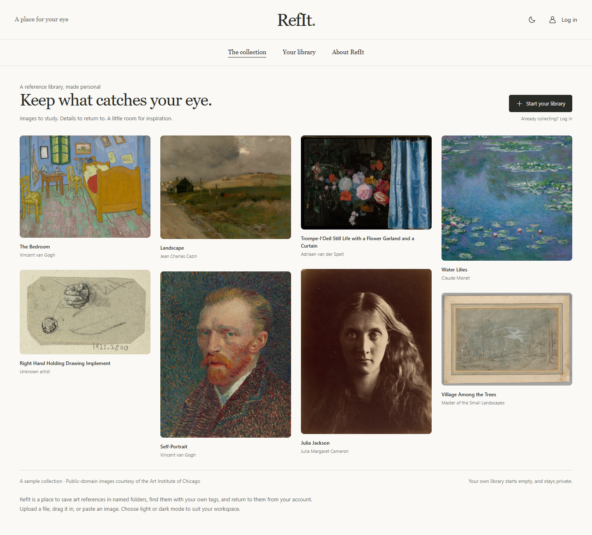

# RefIt

A personal art-reference library built with **Python, Django, HTML, and CSS**, with a small vanilla-JavaScript layer for uploads and interface controls.



## What it does

- Create an account and keep a private library on the server.
- Upload multiple images, drag files onto the page, or paste image data from the clipboard.
- Organize references in named folders; rename folders and move images between them.
- Create custom tags and search by title, notes, or `#tag`.
- Save favorites, download untouched originals, and move images to recoverable Trash.
- Switch between light and dark themes. The preference is saved in your browser.
- Browse a responsive masonry gallery with thumbnails and paginated results.

PNG, JPEG, WebP, GIF, BMP, and TIFF are supported. Previews use the first frame/page; original files are preserved. SVG uploads are deliberately unsupported. There is **no application limit on the number of images**. Each image is limited to 25 MB and 40 megapixels; total capacity depends on your server's disk and hosting plan. Trash continues to use storage.

Color picking / palette extraction is deferred to a later version.

## Run locally

Requires Python 3.11 or newer.

```powershell
python -m venv .venv
.venv\Scripts\python -m pip install -r requirements.lock
.venv\Scripts\python manage.py migrate
.venv\Scripts\python manage.py runserver
```

Open **http://127.0.0.1:8000** and create an account. On Windows, `./start.ps1` can initialize the environment and run the app as well. If `python` points to the Microsoft Store alias, pass your interpreter explicitly: `./start.ps1 -PythonPath 'C:\path\to\python.exe'`.

The public sample gallery is separate from real accounts. Creating an account starts an empty library. No default account or password is installed.

## Storage and backups

The SQLite database, original images, and thumbnails live in `.data/` by default. Set `REFIT_DATA_DIR` to an absolute path to choose another persistent directory. Account login saves your data on that server; it does not provision cloud storage or make backups automatically.

For a consistent backup, stop the server and copy the entire data directory to a separate disk or backup service. Store production secrets separately in your host's secret manager. Restore both the database and image files together, then run `manage.py migrate`. Test restoration before relying on a backup. Never commit backups, account databases, uploaded images, or secrets to Git.

For account recovery on a trusted local server, an operator can run `python manage.py changepassword <username>`. Self-service password recovery and email verification are not implemented yet.

## Deploying

This repository is a working application, not a hosted service. GitHub Pages cannot run its Python server. Use a Python-capable host with a persistent disk and HTTPS.

1. Install `requirements.lock` and mount a persistent directory for `REFIT_DATA_DIR`.
2. Set `DJANGO_DEBUG=0`, a long random `DJANGO_SECRET_KEY`, and `DJANGO_ALLOWED_HOSTS=your-domain.example`.
3. Run `python manage.py migrate` and `python manage.py collectstatic --noinput`.
4. Run `waitress-serve --listen=127.0.0.1:8000 refit.wsgi:application` behind an HTTPS reverse proxy.
5. Set `REFIT_TRUST_PROXY=1` only if the proxy strips client-supplied forwarding headers and sets `X-Forwarded-Proto` itself. Forward the original host.
6. Limit request bodies to roughly 28 MB at the proxy and configure backups, monitoring, disk alerts, and signup abuse protection before a broad public launch.
7. Run `python manage.py check --deploy` with production environment variables.

Uploaded images are served only through authenticated, owner-checked routes. Do **not** expose `.data/images` as a public static directory. The current SQLite/filesystem setup is intended for a single server; multiple application instances need a shared database and private object-storage integration.

See [Django's deployment checklist](https://docs.djangoproject.com/en/5.2/howto/deployment/checklist/) for host configuration.

## Development and verification

```powershell
.venv\Scripts\python -m pip install -r requirements-dev.txt
.venv\Scripts\ruff check .
.venv\Scripts\python manage.py check
.venv\Scripts\python manage.py makemigrations --check --dry-run
.venv\Scripts\python manage.py collectstatic --noinput
.venv\Scripts\python manage.py test gallery
.venv\Scripts\python scripts/browser_check.py
```

The browser check uses an isolated, temporary database and image directory. It uses installed Chrome on Windows, or Playwright Chromium (`python -m playwright install chromium`). Override `REFIT_CHROME` for another executable. Screenshots go to ignored `.local/qa/`. Paste/drop checks dispatch browser events with real image data; native OS clipboard permissions and file-manager dragging still need manual acceptance.

## Credits

Design direction follows the user's RefIt wireframe and gallery-header reference, with guidance from [unslop](https://github.com/heydamir/unslop) by **Damir Sokolovsky**, licensed [CC BY 4.0](https://creativecommons.org/licenses/by/4.0/). See [design notes](docs/design.md).

Sample images are public-domain works provided under CC0 by the **Art Institute of Chicago**. Each work was checked for `is_public_domain: true` through the museum's API. Titles, artists, image URLs, and source links are recorded in [gallery/sample_art.json](gallery/sample_art.json). These samples are not uploaded into user accounts. See [third-party notices](THIRD_PARTY_NOTICES.md).
